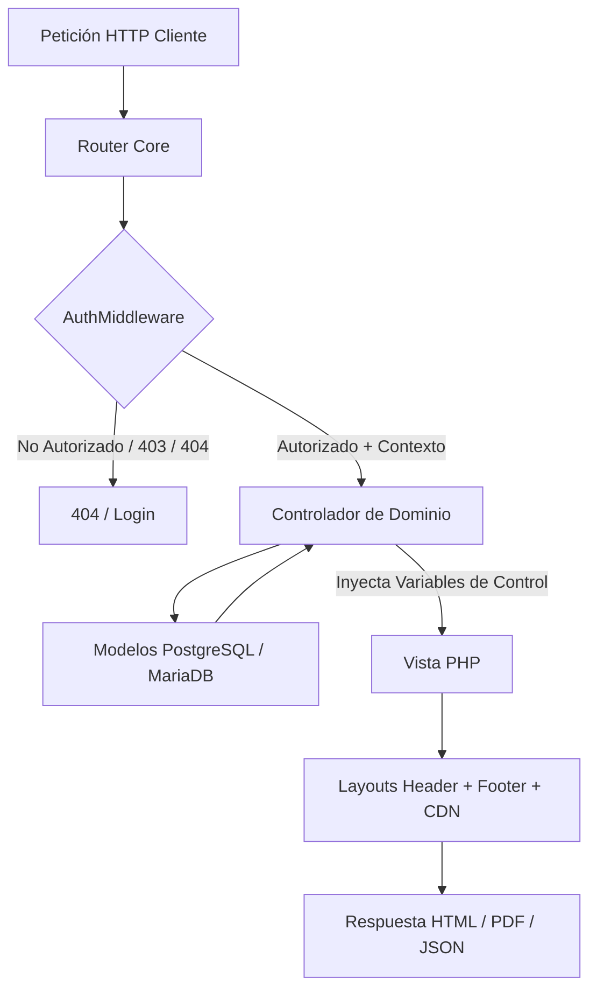

# 🗺️ VitalSenior: Mapa Técnico de Vistas, Controladores y Flujos de Datos

> **Documentación Técnica Canónica del Ecosistema MVC de VitalSenior**  
> **Skill de Referencia:** `php-view-flow-guardian`  
> **Fecha de Actualización:** 25 de Septiembre, 2026

---

## 📌 Índice General

1. [Arquitectura y Convenciones de Flujo MVC](#1-arquitectura-y-convenciones-de-flujo-mvc)
2. [Mapeo de Vistas por Módulo Funcional](#2-mapeo-de-vistas-por-módulo-funcional)
   - [2.1 Autenticación y Recuperación](#21-autenticación-y-recuperación)
   - [2.2 Home e Información Pública](#22-home-e-información-pública)
   - [2.3 Dashboards y Paneles Principales](#23-dashboards-y-paneles-principales)
   - [2.4 Ecosistema Clínico del Doctor](#24-ecosistema-clínico-del-doctor)
   - [2.5 Portal Médico Externo con PIN Temporal](#25-portal-médico-externo-con-pin-temporal)
   - [2.6 Gestión de Expedientes y Familiares](#26-gestión-de-expedientes-y-familiares)
   - [2.7 Monitoreo de Salud y Signos Vitales](#27-monitoreo-de-salud-y-signos-vitales)
   - [2.8 Farmacoterapia y Control de Tomas](#28-farmacoterapia-y-control-de-tomas)
   - [2.9 Agenda de Citas Médicas y Laboratorios](#29-agenda-de-citas-médicas-y-laboratorios)
   - [2.10 Bitácora de Visitas Médicas](#210-bitácora-de-visitas-médicas)
   - [2.11 Ficha de Emergencia SOS Pública](#211-ficha-de-emergencia-sos-pública)
   - [2.12 Perfil y Seguridad de Usuario](#212-perfil-y-seguridad-de-usuario)
   - [2.13 Layouts, Componentes Globales y Páginas de Error](#213-layouts-componentes-globales-y-páginas-de-error)
3. [Matriz de Roles y Niveles de Acceso](#3-matriz-de-roles-y-niveles-de-acceso)
4. [Métricas Globales de Interacción](#4-métricas-globales-de-interacción)

---

## 1. Arquitectura y Convenciones de Flujo MVC

VitalSenior opera bajo un patrón arquitectónico MVC modular estricto con aislamiento multitenant y control de acceso basado en roles y niveles de vinculación:

### Variables Canónicas de Control Inyectadas
- `$pacienteId` / `$pacienteActivoId`: Identificador del adulto mayor en contexto activo.
- `$nivelAcceso`: Nivel de vinculación sobre el paciente (`'principal'`, `'completo'`, `'solo_lectura'`, `'doctor'`, `'paciente'`).
- `$esDoctor`: Booleano determinando si el usuario autenticado tiene rol de médico (`$rol === 'doctor'`).
- `$puedeEditar`: Booleano (`in_array($nivelAcceso, ['principal', 'completo']) && !$esDoctor`).
- `$puedeSuministrar`: Booleano (`in_array($nivelAcceso, ['principal', 'completo']) || $rol === 'paciente'`).

---

## 2. Mapeo de Vistas por Módulo Funcional

---

### 2.1 Autenticación y Recuperación

#### 📄 `src/Views/auth/login.php`
- **Endpoint:** `GET /login` / `GET /register`
- **Propósito:** Inicio de sesión unificado y registro de nuevos cuidadores, familiares y médicos. Incluye carrusel institucional y tabuladores dinámicos.
- **Controlador Emisor:** `AuthController::showLoginForm()` / `AuthController::showRegisterForm()`
- **Modelos Involucrados:** `Usuario`
- **Tabla de Acciones e Interacciones:**

| Elemento UI | Tipo | Acción / Destino | Restricción por Rol / Nivel |
| :--- | :--- | :--- | :--- |
| Formulario de Login | Formulario `POST` | `POST /login` | Invitados (`guestOnly`) |
| Formulario de Registro | Formulario `POST` | `POST /register` | Invitados (`guestOnly`) |
| Pestaña "Iniciar Sesión" | Función JS | `switchTab('login')` | Público |
| Pestaña "Registrarse" | Función JS | `switchTab('register')` | Público |
| Enlace "¿Olvidaste tu contraseña?" | Enlace `<a>` | `GET /recovery` | Invitados |
| Enlace "Términos y Privacidad" | Enlace `<a>` | `GET /privacidad` | Público |

---

#### 📄 `src/Views/auth/recovery.php`
- **Endpoint:** `GET /recovery`
- **Propósito:** Solicitud de código / token de restablecimiento de contraseña vía correo electrónico institucional.
- **Controlador Emisor:** `RecoveryController::showRecoveryForm()`
- **Modelos Involucrados:** `Usuario`, `PasswordReset`
- **Tabla de Acciones e Interacciones:**

| Elemento UI | Tipo | Acción / Destino | Restricción por Rol / Nivel |
| :--- | :--- | :--- | :--- |
| Formulario Solicitar Token | Formulario `POST` | `POST /recovery` | Invitados (`guestOnly`) |
| Enlace "Regresar al Login" | Enlace `<a>` | `GET /login` | Invitados |

---

#### 📄 `src/Views/auth/new_password.php`
- **Endpoint:** `GET /new-password?token=...`
- **Propósito:** Formulario de cambio seguro de contraseña con validación de fortaleza y confirmación.
- **Controlador Emisor:** `RecoveryController::showNewPasswordForm()`
- **Modelos Involucrados:** `PasswordReset`, `Usuario`
- **Tabla de Acciones e Interacciones:**

| Elemento UI | Tipo | Acción / Destino | Restricción por Rol / Nivel |
| :--- | :--- | :--- | :--- |
| Formulario Nueva Contraseña | Formulario `POST` | `POST /new-password` | Token válido |
| Toggle Ver Contraseña | Función JS | `togglePasswordVisibility()` | Público |
| Enlace "Cancelar" | Enlace `<a>` | `GET /login` | Invitados |

---

#### 📄 `src/Views/auth/password_updated.php`
- **Endpoint:** `GET /password-updated`
- **Propósito:** Pantalla de confirmación de éxito tras la actualización de contraseña.
- **Controlador Emisor:** `RecoveryController::showPasswordUpdated()`
- **Modelos Involucrados:** Ninguno (Vista estática informativa)
- **Tabla de Acciones e Interacciones:**

| Elemento UI | Tipo | Acción / Destino | Restricción por Rol / Nivel |
| :--- | :--- | :--- | :--- |
| Botón "Iniciar Sesión Ahora" | Enlace `<a>` | `GET /login` | Invitados |

---

#### 📄 `src/Views/emails/recovery_email.php`
- **Endpoint:** `N/A` (Plantilla de correo enviada por PHPMailer / MailerService)
- **Propósito:** Plantilla HTML institucional para el correo electrónico de recuperación de contraseña con botón CTA.
- **Controlador Emisor:** `RecoveryController::sendToken()`
- **Modelos Involucrados:** `PasswordReset`
- **Tabla de Acciones e Interacciones:**

| Elemento UI | Tipo | Acción / Destino | Restricción por Rol / Nivel |
| :--- | :--- | :--- | :--- |
| Botón CTA en Email | Enlace `<a>` | `GET /new-password?token=...` | Destinatario del correo |

---

### 2.2 Home e Información Pública

#### 📄 `src/Views/home/index.php`
- **Endpoint:** `GET /`
- **Propósito:** Landing page institucional de VitalSenior con carrusel accesible de módulos clínicos, propuesta de valor, testimonios y llamada a la acción (CTA).
- **Controlador Emisor:** `HomeController::index()`
- **Modelos Involucrados:** Ninguno (Presentación estática)
- **Tabla de Acciones e Interacciones:**

| Elemento UI | Tipo | Acción / Destino | Restricción por Rol / Nivel |
| :--- | :--- | :--- | :--- |
| Botón CTA "Iniciar Sesión" | Enlace `<a>` | `GET /login` | Público |
| Botón CTA "Registrarse Gratis" | Enlace `<a>` | `GET /register` | Público |
| Carrusel: Flecha Anterior | Función JS | `slidePrev()` | Accesible por teclado |
| Carrusel: Flecha Siguiente | Función JS | `slideNext()` | Accesible por teclado |
| Carrusel: Indicadores (Dots) | Función JS | `goToSlide(index)` | Micro-interacción |
| Botón "Ver Demostración SOS" | Enlace `<a>` | `GET /emergencia?token=demo` | Público |

---

### 2.3 Dashboards y Paneles Principales

#### 📄 `src/Views/dashboard/cuidador.php`
- **Endpoint:** `GET /dashboard` (Usuarios con roles `familiar_admin`, `cuidador`, `cuidador_auxiliar`, `admin`)
- **Propósito:** Panel de control 360° del paciente activo. Muestra KPIs de signos vitales, próximas tomas de medicamentos, citas agendadas, selector rápido de perfiles, red SOS y accesos a PDF y PIN Médico.
- **Controlador Emisor:** `DashboardController::index()`
- **Modelos Involucrados:** `Paciente`, `Cuidador`, `RegistroSaludDiario`, `Medicamento`, `CitaLaboratorio`, `ContactoEmergencia`, `VisitaMedica`
- **Tabla de Acciones e Interacciones:**

| Elemento UI | Tipo | Acción / Destino | Restricción por Rol / Nivel |
| :--- | :--- | :--- | :--- |
| Selector de Paciente Activo | Formulario `POST` | `POST /paciente/seleccionar` | Múltiples perfiles vinculados |
| Botón "Nuevo Perfil" | Enlace `<a>` | `GET /pacientes/crear` | Cuidador / Familiar |
| Botón "Unirse con NIP" | Función JS / Modal | `abrirModalUnirseNip()` | Cuidador / Familiar |
| Botón "PIN Médico" | Función JS / Modal | `abrirModalPinMedico()` | Familiar Admin / Cuidador |
| Botón "Ficha QR" | Enlace `<a>` | `GET /emergencia?token=...` | Público en nueva pestaña |
| Botón "Descargar Reporte PDF" | Enlace `<a>` | `GET /pacientes/reporte-pdf?paciente_id=...` | Todos los vinculados |
| Menú Usuario (Perfil / Salir) | Función JS | `toggleUserDropdownMenu()` | Sesión activa |
| Botón SOS de Emergencia | Función JS / AJAX | `dispararAlertaSOS()` -> `POST /api/sos` | Cuidador / Paciente |
| Tarjeta Toma: "Tomar Dosis" | Formulario `POST` | `POST /medicamentos/toma` | `$puedeSuministrar === true` |
| Tarjeta Toma: "Posponer 15m" | Formulario `POST` | `POST /medicamentos/posponer` | `$puedeSuministrar === true` |
| Botón "Registrar Signos" | Enlace `<a>` | `GET /salud/stepper` | Requiere permiso |
| Botón "Agendar Cita" | Enlace `<a>` | `GET /citas` | Cuidador / Médico |
| Botón "Bitácora Post-Consulta" | Enlace `<a>` | `GET /visitas/nueva` | Cuidador / Médico |
| Botón "Ver Expediente" | Enlace `<a>` | `GET /expediente` | Vinculados |

---

#### 📄 `src/Views/dashboard/index.php`
- **Endpoint:** `GET /dashboard` (Fallback / Vista general de redirección según rol)
- **Propósito:** Vista base y contenedor de bienvenida que redirige al dashboard especializado correspondiente.
- **Controlador Emisor:** `DashboardController::index()`
- **Modelos Involucrados:** `Paciente`, `Cuidador`
- **Tabla de Acciones e Interacciones:**

| Elemento UI | Tipo | Acción / Destino | Restricción por Rol / Nivel |
| :--- | :--- | :--- | :--- |
| Botón "Ir a mi Panel" | Enlace `<a>` | `GET /dashboard` | Sesión activa |
| Enlace "Cerrar Sesión" | Enlace `<a>` | `GET /logout` | Sesión activa |

---

### 2.4 Ecosistema Clínico del Doctor

#### 📄 `src/Views/doctor/dashboard.php`
- **Endpoint:** `GET /doctor/dashboard`
- **Propósito:** Panel clínico del médico tratante. Listado de pacientes asignados, búsqueda por nombre o folio, estado de adherencia farmacológica, alertas de signos vitales y vinculación rápida de pacientes.
- **Controlador Emisor:** `DoctorController::dashboard()`
- **Modelos Involucrados:** `Doctor`, `Paciente`, `RegistroSaludDiario`, `Medicamento`
- **Tabla de Acciones e Interacciones:**

| Elemento UI | Tipo | Acción / Destino | Restricción por Rol / Nivel |
| :--- | :--- | :--- | :--- |
| Formulario Vincular Paciente | Formulario `POST` | `POST /doctor/paciente/vincular` | Rol Doctor |
| Botón "Ver Expediente Clínico" | Enlace `<a>` | `GET /doctor/paciente/expediente?id=...` | Paciente asignado al Doctor |
| Botón "Emitir Receta" | Enlace `<a>` | `GET /doctor/recetas/nueva?paciente_id=...` | Rol Doctor |
| Botón "Descargar PDF Clínico" | Enlace `<a>` | `GET /doctor/paciente/pdf?id=...` | Paciente asignado al Doctor |
| Filtro de Búsqueda de Pacientes | Función JS | `filtrarPacientes(query)` | Búsqueda en vivo |

---

#### 📄 `src/Views/doctor/expediente.php`
- **Endpoint:** `GET /doctor/paciente/expediente?id=...`
- **Propósito:** Vista médica especializada para doctores con historial completo de signos vitales, notas de evolución privada, recetas emitidas y visor de estudios de laboratorio.
- **Controlador Emisor:** `DoctorController::expediente()`
- **Modelos Involucrados:** `Doctor`, `Paciente`, `RegistroSaludDiario`, `Medicamento`, `VisitaMedica`
- **Tabla de Acciones e Interacciones:**

| Elemento UI | Tipo | Acción / Destino | Restricción por Rol / Nivel |
| :--- | :--- | :--- | :--- |
| Formulario Guardar Nota Evolución | Formulario `POST` | `POST /doctor/paciente/notas` | Rol Doctor |
| Botón "Nueva Prescripción" | Enlace `<a>` | `GET /doctor/recetas/nueva?paciente_id=...` | Rol Doctor |
| Botón "Descargar PDF Clínico" | Enlace `<a>` | `GET /doctor/paciente/pdf?id=...` | Paciente asignado al Doctor |
| Pestañas de Navegación Clínica | Función JS | `switchTabDoctor(tabId)` | Rol Doctor |
| Botón "Volver al Dashboard" | Enlace `<a>` | `GET /doctor/dashboard` | Rol Doctor |

---

#### 📄 `src/Views/doctor/receta_form.php`
- **Endpoint:** `GET /doctor/recetas/nueva?paciente_id=...`
- **Propósito:** Generador y emisor formal de recetas médicas electrónicas con cédula profesional, diagnóstico CIE y posología de medicamentos.
- **Controlador Emisor:** `DoctorController::crearReceta()`
- **Modelos Involucrados:** `Doctor`, `Paciente`, `Medicamento`
- **Tabla de Acciones e Interacciones:**

| Elemento UI | Tipo | Acción / Destino | Restricción por Rol / Nivel |
| :--- | :--- | :--- | :--- |
| Formulario Guardar Receta | Formulario `POST` | `POST /doctor/recetas/guardar` | Rol Doctor |
| Botón "Agregar Fármaco a Receta" | Función JS | `agregarRenglonMedicamento()` | Dinámico en cliente |
| Botón "Eliminar Fármaco" | Función JS | `eliminarRenglon(btn)` | Dinámico en cliente |
| Botón "Cancelar" | Enlace `<a>` | `GET /doctor/paciente/expediente?id=...` | Rol Doctor |

---

### 2.5 Portal Médico Externo con PIN Temporal

#### 📄 `src/Views/medico/portal_consulta.php`
- **Endpoint:** `GET /medico/consulta?pin=...`
- **Propósito:** Portal de acceso temporal para médicos de urgencias o consulta externa autorizados mediante PIN temporal (sin requerir login previo).
- **Controlador Emisor:** `MedicoPortalController::consulta()`
- **Modelos Involucrados:** `TokenAccesoMedico`, `Paciente`, `RegistroSaludDiario`, `Medicamento`, `ContactoEmergencia`, `VisitaMedica`
- **Tabla de Acciones e Interacciones:**

| Elemento UI | Tipo | Acción / Destino | Restricción por Rol / Nivel |
| :--- | :--- | :--- | :--- |
| Formulario Agregar Nota Médica | Formulario `POST` | `POST /medico/guardar-nota` | PIN Activo y Válido |
| Botón "Descargar Resumen PDF" | Enlace `<a>` | `GET /paciente/pdf?id=...` | PIN Válido |
| Visor de Estudios Adjuntos | Función JS / Modal | `abrirVisorClínico(url, nombre)` | PIN Válido |
| Modal Visor: Botón Cerrar | Función JS | `cerrarVisorClínico()` | Público con PIN |

---

#### 📄 `src/Views/medico/pin_invalido.php`
- **Endpoint:** `GET /medico/consulta` (Cuando el PIN ha expirado o es erróneo)
- **Propósito:** Notificación de seguridad bloqueando el acceso ante un PIN de 6 dígitos expirado o inexistente.
- **Controlador Emisor:** `MedicoPortalController::consulta()`
- **Modelos Involucrados:** `TokenAccesoMedico`
- **Tabla de Acciones e Interacciones:**

| Elemento UI | Tipo | Acción / Destino | Restricción por Rol / Nivel |
| :--- | :--- | :--- | :--- |
| Botón "Ir al Inicio" | Enlace `<a>` | `GET /` | Público |

---

### 2.6 Gestión de Expedientes y Familiares

#### 📄 `src/Views/pacientes/expediente.php`
- **Endpoint:** `GET /expediente` / `GET /expediente?paciente_id=...`
- **Propósito:** Expediente clínico integral y gerencial. Administra datos biográficos, antecedentes patológicos, red SOS, médicos tratantes, historial de visitas, recetas y prescripciones médicas, cuidadores vinculados (con regeneración de NIP) y repositorio de archivos médicos.
- **Controlador Emisor:** `PacienteController::expediente()`
- **Modelos Involucrados:** `Paciente`, `Cuidador`, `Medicamento`, `ContactoEmergencia`, `RegistroSaludDiario`, `VisitaMedica`, `Doctor`
- **Tabla de Acciones e Interacciones:**

| Elemento UI | Tipo | Acción / Destino | Restricción por Rol / Nivel |
| :--- | :--- | :--- | :--- |
| Badge Nivel de Acceso | Componente UI | Dinámico (Corona / Candado / Médico) | Informativo |
| Botón "Emitir Receta" | Enlace `<a>` | `GET /doctor/recetas/nueva?paciente_id=...` | `$esDoctor === true` |
| Botón "Descargar Reporte PDF" | Enlace `<a>` | `GET /pacientes/reporte-pdf?paciente_id=...` | Vinculados |
| Botón "Ver Credencial QR" | Función JS / Modal | `abrirModalQR(uuid, nombre)` | Vinculados |
| Pestañas (Datos / Antecedentes / Contactos / Médicos / Visitas / Recetas) | Función JS | `switchTab(tabId)` | Interfaz |
| Pestaña "Recetas y Prescripciones" | Pestaña Clínica | `#tab-recetas` (diagnóstico, fecha, indicaciones y médico emisor) | Vinculados |
| Formulario Actualizar Expediente | Formulario `POST` | `POST /expediente/actualizar` | `$puedeEditar === true` |
| Formulario Añadir Contacto SOS | Formulario `POST` | `POST /expediente/anadir_contacto` | `$puedeEditar === true` |
| Formulario Eliminar Contacto SOS | Formulario `POST` | `POST /expediente/eliminar_contacto` | `$puedeEditar === true` |
| Formulario Asignar Médico | Formulario `POST` | `POST /expediente/anadir_doctor` | `$puedeEditar === true` |
| Formulario Desvincular Médico | Formulario `POST` | `POST /expediente/eliminar_doctor` | `$puedeEditar === true` |
| Formulario Subir Archivo/Estudio | Formulario `POST` | `POST /expediente/archivos/subir` | `$puedeEditar === true` |
| Botón Descargar Archivo Adjunto | Enlace `<a>` | `GET /expediente/archivos/descargar?id=...` | Vinculados |
| Lightbox Visualizador de Archivo | Función JS / Modal | `abrirLightbox(url, nombre)` | Vinculados |
| Botón "Regenerar NIP Familiar" | Formulario `POST` | `POST /paciente/regenerar-nip` | `$puedeEditar === true` |
| Botón "Desvincular Cuidador" | Formulario `POST` | `POST /paciente/desvincular-cuidador` | `$puedeEditar === true` |
| Botón "Imprimir Carnet QR" | Función JS | `imprimirCarnetQR()` | Exclusivo impresión carnet |

---

#### 📄 `src/Views/pacientes/crear.php`
- **Endpoint:** `GET /pacientes/crear`
- **Propósito:** Registro de un nuevo adulto mayor administrado bajo la tutela del cuidador autenticado.
- **Controlador Emisor:** `PacienteController::crear()`
- **Modelos Involucrados:** `Paciente`, `Cuidador`
- **Tabla de Acciones e Interacciones:**

| Elemento UI | Tipo | Acción / Destino | Restricción por Rol / Nivel |
| :--- | :--- | :--- | :--- |
| Formulario Crear Paciente | Formulario `POST` | `POST /pacientes/guardar` | Cuidador / Familiar |
| Botón "Cancelar y Volver" | Enlace `<a>` | `GET /dashboard` | Sesión activa |

---

#### 📄 `src/Views/pacientes/vincular.php`
- **Endpoint:** `GET /vincular` / `GET /pacientes/vincular`
- **Propósito:** Centralizado en el modal de `cuidador.php`. Al acceder por URL directa realiza redirección limpia hacia `GET /dashboard?abrir_nip=1` para unificar la experiencia de usuario.
- **Controlador Emisor:** `VinculacionController::showForm()`
- **Modelos Involucrados:** `Paciente`, `Cuidador`
- **Tabla de Acciones e Interacciones:**

| Elemento UI | Tipo | Acción / Destino | Restricción por Rol / Nivel |
| :--- | :--- | :--- | :--- |
| Redirección Automática | Cabecera HTTP / JS | `GET /dashboard?abrir_nip=1` | Sesión activa |

---

#### 📄 `src/Views/pacientes/pdf_resumen.php`
- **Endpoint:** `GET /pacientes/reporte-pdf?paciente_id=...` (Renderizado compilado por Dompdf)
- **Propósito:** Plantilla formal en PDF con tablas clínicas exhaustivas: demografía, signos vitales históricos, farmacoterapia activa con adherencia semanal (%), red SOS, recetas médicas, bitácoras de consultas y sello médico.
- **Controlador Emisor:** `PacienteController::descargarReporte()` / `DoctorController::descargarReporteClinico()` / `PdfReportService`
- **Modelos Involucrados:** `Paciente`, `Medicamento`, `ContactoEmergencia`, `RegistroSaludDiario`, `Doctor`, `VisitaMedica`
- **Tabla de Acciones e Interacciones:**
  *Documento estático de compilación binaria PDF (sin elementos interactivos web).*

---

#### 📄 `src/Views/pacientes/pdf_receta.php`
- **Endpoint:** `GET /pacientes/receta-pdf?id=...` (Renderizado compilado por Dompdf)
- **Propósito:** Plantilla formal de prescripción médica oficial con membrete del doctor, cédula profesional, datos del paciente, diagnóstico, tabla Rx de medicamentos prescritos (dosis, frecuencia, indicaciones) y recomendaciones terapéuticas.
- **Controlador Emisor:** `PacienteController::descargarRecetaPdf()` / `PdfReportService`
- **Modelos Involucrados:** `Doctor`, `Paciente`, `Medicamento`
- **Tabla de Acciones e Interacciones:**
  *Documento estático de compilación binaria PDF (sin elementos interactivos web).*

---

### 2.7 Monitoreo de Salud y Signos Vitales

#### 📄 `src/Views/salud/stepper.php`
- **Endpoint:** `GET /salud` / `GET /salud/stepper`
- **Propósito:** Formulario interactivo por pasos (*Stepper*) con botones accesibles de tamaño mínimo 48x48px y cálculo reactivo de IMC en tiempo real.
  - Paso 1: Presión Arterial (Sistólica / Diastólica).
  - Paso 2: Nivel de Glucosa (mg/dL) y Momento de la Toma.
  - Paso 3: Pulso Cardíaco (lpm), Horas de Sueño y Escala Visual de Dolor (0-4).
  - Paso 4: Peso Corporal (kg), Altura (cm) e IMC en vivo.
- **Controlador Emisor:** `SaludController::stepper()`
- **Modelos Involucrados:** `Paciente`, `RegistroSaludDiario`, `SaludEvaluatorService`
- **Tabla de Acciones e Interacciones:**

| Elemento UI | Tipo | Acción / Destino | Restricción por Rol / Nivel |
| :--- | :--- | :--- | :--- |
| Botón "Cancelar" | Enlace `<a>` | `GET /dashboard` | Sesión activa |
| Paso 1: "Siguiente: Glucosa" | Botón `type="button"` | `nextStep(2); event.preventDefault();` | Validación de presión |
| Paso 2: "← Atrás" | Botón `type="button"` | `prevStep(1); event.preventDefault();` | Decremento limpio |
| Paso 2: "Siguiente: Pulso" | Botón `type="button"` | `nextStep(3); event.preventDefault();` | Validación de glucosa |
| Paso 3: "← Atrás" | Botón `type="button"` | `prevStep(2); event.preventDefault();` | Decremento limpio |
| Paso 3: "Siguiente: Peso" | Botón `type="button"` | `nextStep(4); event.preventDefault();` | Interfaz |
| Paso 4: "← Atrás" | Botón `type="button"` | `prevStep(3); event.preventDefault();` | Decremento limpio |
| Input Peso & Altura | Evento JS `oninput` | `calcularImcEnVivo()` | Cálculo inmediato |
| Botón "✓ Guardar Signos Vitales" | Botón `type="submit"` | `POST /salud/registrar` | Requiere permiso |
| Modal Confirmación: "Sí, es correcto" | Botón `type="button"` | `confirmAndProceed()` | Rango atípico |
| Modal Confirmación: "Corregir" | Botón `type="button"` | `goBackToEdit()` | Rango atípico |

---

#### 📄 `src/Views/salud/confirmar.php`
- **Endpoint:** `GET /salud/confirmar`
- **Propósito:** Vista de alerta de seguridad médica cuando los valores de presión o glucosa se encuentran en umbrales críticos de emergencia.
- **Controlador Emisor:** `SaludController::mostrarConfirmacion()`
- **Modelos Involucrados:** `Paciente`, `RegistroSaludDiario`
- **Tabla de Acciones e Interacciones:**

| Elemento UI | Tipo | Acción / Destino | Restricción por Rol / Nivel |
| :--- | :--- | :--- | :--- |
| Formulario Forzar Guardado | Formulario `POST` | `POST /salud/registrar` (`confirmado_por_usuario=1`) | Cuidador |
| Botón "Reescribir / Volver" | Enlace `<a>` | `GET /salud/stepper` | Cuidador |

---

### 2.8 Farmacoterapia y Control de Tomas

#### 📄 `src/Views/medicamentos/index.php`
- **Endpoint:** `GET /medicamentos`
- **Propósito:** Inventario integral de medicamentos prescritos y panel de configuración de posología, stock y horarios.
- **Controlador Emisor:** `MedicamentoController::index()`
- **Modelos Involucrados:** `Medicamento`, `Paciente`
- **Tabla de Acciones e Interacciones:**

| Elemento UI | Tipo | Acción / Destino | Restricción por Rol / Nivel |
| :--- | :--- | :--- | :--- |
| Formulario Registrar Fármaco | Formulario `POST` | `POST /medicamentos/crear` | `$puedeEditar === true` |
| Botón "Pausar / Reanudar" | Formulario `POST` | `POST /medicamentos/pausar` | `$puedeEditar === true` |
| Botón "Eliminar Fármaco" | Formulario `POST` | `POST /medicamentos/eliminar` | `$puedeEditar === true` |
| Enlace "Ir a Control de Tomas" | Enlace `<a>` | `GET /medicamentos/control` | Vinculados |
| Enlace "Emitir Receta Médica" | Enlace `<a>` | `GET /doctor/recetas/nueva?paciente_id=...` | `$esDoctor === true` |

---

#### 📄 `src/Views/medicamentos/control_tomas.php`
- **Endpoint:** `GET /medicamentos/control`
- **Propósito:** Tablero de suministros farmacológicos del día organizado por bloques horarios (Mañana, Tarde, Noche) con contador de adherencia.
- **Controlador Emisor:** `MedicamentoController::controlTomas()`
- **Modelos Involucrados:** `Medicamento`, `Paciente`
- **Tabla de Acciones e Interacciones:**

| Elemento UI | Tipo | Acción / Destino | Restricción por Rol / Nivel |
| :--- | :--- | :--- | :--- |
| Botón "Volver al Dashboard" | Enlace `<a>` | `GET /dashboard` | Vinculados |
| Botón "Gestionar Inventario" | Enlace `<a>` | `GET /medicamentos` | `$puedeEditar === true` |
| Render de Tarjetas de Toma | Componente Parcial | `partials/card_toma.php` | Según privilegios |

---

#### 📄 `src/Views/medicamentos/partials/card_toma.php`
- **Endpoint:** Componente Parcial Modular
- **Propósito:** Renderizado de la tarjeta de dosis individual con micro-interacciones de suministro y descontado de stock.
- **Controlador Emisor:** Invocado desde `dashboard/cuidador.php` y `medicamentos/control_tomas.php`
- **Modelos Involucrados:** `Medicamento`
- **Tabla de Acciones e Interacciones:**

| Elemento UI | Tipo | Acción / Destino | Restricción por Rol / Nivel |
| :--- | :--- | :--- | :--- |
| Botón "✓ Marcar Toma" | Formulario `POST` | `POST /medicamentos/toma` | `$puedeSuministrar === true` |
| Botón "⏱️ Posponer 15 min" | Formulario `POST` | `POST /medicamentos/posponer` | `$puedeSuministrar === true` |
| Botón "↩️ Deshacer Registro" | Formulario `POST` | `POST /medicamentos/deshacer` | `$puedeSuministrar === true` |
| Píldora Estado "Dosis Tomada" | Badge Estático | Informativo | `$puedeSuministrar === false` |
| Píldora Estado "Pendiente" | Badge Estático | Informativo | `$puedeSuministrar === false` |

---

### 2.9 Agenda de Citas Médicas y Laboratorios

#### 📄 `src/Views/citas/index.php`
- **Endpoint:** `GET /citas`
- **Propósito:** Gestión de calendario médico, citas geriátricas, exámenes de laboratorio y exportación de recordatorios en formato `.ics` para Google Calendar / Apple Calendar.
- **Controlador Emisor:** `CitaController::index()`
- **Modelos Involucrados:** `CitaLaboratorio`, `Paciente`
- **Tabla de Acciones e Interacciones:**

| Elemento UI | Tipo | Acción / Destino | Restricción por Rol / Nivel |
| :--- | :--- | :--- | :--- |
| Formulario Agendar Cita | Formulario `POST` | `POST /citas/crear` | Cuidador / Médico |
| Botón "Marcar Completada" | Formulario `POST` | `POST /citas/completar` | Cuidador / Médico |
| Botón "Cancelar Cita" | Formulario `POST` | `POST /citas/cancelar` | Cuidador / Médico |
| Botón "Exportar a Calendario (.ics)" | Enlace `<a>` | `GET /citas/ics?id=...` | Vinculados |
| Botón "Volver al Dashboard" | Enlace `<a>` | `GET /dashboard` | Vinculados |

---

### 2.10 Bitácora de Visitas Médicas

#### 📄 `src/Views/visitas/nueva.php`
- **Endpoint:** `GET /visitas/nueva`
- **Propósito:** Registro post-consulta médica para documentar motivo de atención, indicaciones del especialista, diagnóstico y subida de recetas escaneadas / fotos.
- **Controlador Emisor:** `VisitaMedicaController::create()`
- **Modelos Involucrados:** `VisitaMedica`, `Paciente`
- **Tabla de Acciones e Interacciones:**

| Elemento UI | Tipo | Acción / Destino | Restricción por Rol / Nivel |
| :--- | :--- | :--- | :--- |
| Formulario Guardar Visita Médica | Formulario `POST` | `POST /visitas/guardar` (Multipart) | Cuidador / Médico |
| Botones Rápidos de Lugar (IMSS, Cruz Roja, etc.) | Función JS | `setLugar('...')` | Interactividad |
| Botones Rápidos de Motivo (Control, Dolor, etc.) | Función JS | `setMotivo('...')` | Interactividad |
| Input Subida Fotos / Recetas | Input File | `previewArchivos(this)` | Previsualización |
| Botón "Cancelar" | Enlace `<a>` | `GET /dashboard` | Sesión activa |

---

### 2.11 Ficha de Emergencia SOS Pública

#### 📄 `src/Views/emergencia/ficha_publica.php`
- **Endpoint:** `GET /emergencia?token=...`
- **Propósito:** Ficha médica de emergencia accesible por código QR para paramédicos y socorristas (sin autenticación). Muestra tipo de sangre, alergias, enfermedades críticas y botones de llamada directa `tel:` a familiares de auxilio.
- **Controlador Emisor:** `EmergenciaController::showPublicCard()`
- **Modelos Involucrados:** `Paciente`, `ContactoEmergencia`, `Medicamento`
- **Tabla de Acciones e Interacciones:**

| Elemento UI | Tipo | Acción / Destino | Restricción por Rol / Nivel |
| :--- | :--- | :--- | :--- |
| Botón "Llamar Contacto SOS" | Enlace `tel:` | `tel:+52...` | Acceso Público por QR |
| Botón "Llamar 911 Emergencias" | Enlace `tel:` | `tel:911` | Acceso Público por QR |
| Botón "Compartir Ubicación" | Función JS | `navigator.share()` / Geolocation | Dispositivo móvil |

---

### 2.12 Perfil y Seguridad de Usuario

#### 📄 `src/Views/perfil/index.php`
- **Endpoint:** `GET /perfil`
- **Propósito:** Configuración de la cuenta del usuario autenticado (nombre, teléfono, correo), actualización de credenciales de acceso y eliminación definitiva de cuenta.
- **Controlador Emisor:** `PerfilController::index()`
- **Modelos Involucrados:** `Usuario`
- **Tabla de Acciones e Interacciones:**

| Elemento UI | Tipo | Acción / Destino | Restricción por Rol / Nivel |
| :--- | :--- | :--- | :--- |
| Formulario Actualizar Datos Personales | Formulario `POST` | `POST /perfil/actualizar` | Sesión activa |
| Formulario Cambiar Contraseña | Formulario `POST` | `POST /perfil/password` | Sesión activa |
| Formulario Eliminar Cuenta | Formulario `POST` | `POST /perfil/eliminar` | Confirmación previa |
| Botón "Volver al Dashboard" | Enlace `<a>` | `GET /dashboard` | Sesión activa |

---

### 2.13 Layouts, Componentes Globales y Páginas de Error

#### 📄 `src/Views/layouts/header.php`
- **Propósito:** Encabezado principal y Layout superior. Incluye:
  - Selector activo multitenant de adultos mayores (`POST /paciente/seleccionar`).
  - Accesibilidad de fuente en vivo (`A+` / `A-` con persistencia en `localStorage`).
  - Botón de generación de PIN Médico temporal (`abrirModalPinMedico()`).
  - Enlace de descarga directa del Reporte Clínico en PDF (`GET /pacientes/reporte-pdf`).
  - Ficha de emergencia QR (`GET /emergencia?token=...`).
  - Menú de usuario y Drawer móvil adaptativo.

#### 📄 `src/Views/layouts/footer.php`
- **Propósito:** Layout inferior con cierre de etiquetas HTML, inclusión de librerías JS compartidas y pie de página institucional.

#### 📄 `src/Views/layouts/main.php`
- **Propósito:** Envoltorio shell mínimo para vistas modulares.

#### 📄 `src/Views/components/bottom_nav.php`
- **Propósito:** Barra de navegación inferior móvil para cuidadores con accesos directos a Dashboard (`/dashboard`), Signos (`/salud`), Medicinas (`/medicamentos`), Citas (`/citas`) y Expediente (`/expediente`).

#### 📄 `src/Views/components/toast.php`
- **Propósito:** Sistema de alertas y notificaciones Flash (`$_SESSION['flash']`) con auto-cierre y animaciones suaves.

#### 📄 `src/Views/404.php`
- **Propósito:** Pantalla de error 404 asistida para rutas no encontradas u ofuscación de recursos multitenant no autorizados.

---

## 3. Matriz de Roles y Niveles de Acceso

| Módulo / Acción | Paciente Titular | Cuidador Principal (`principal`) | Familiar Secundario (`solo_lectura`) | Médico Tratante (`doctor`) | Público / QR |
| :--- | :---: | :---: | :---: | :---: | :---: |
| **Ver Dashboard & Signos** | ✅ | ✅ | ✅ | ✅ | ❌ |
| **Registrar Signos Vitales** | ✅ | ✅ | ❌ (Bloqueado) | ❌ (Solo Clínico) | ❌ |
| **Suministrar / Marcar Tomas** | ✅ | ✅ | ❌ (HTTP 403) | ❌ (HTTP 403) | ❌ |
| **Editar Expediente & Contactos**| ❌ | ✅ | ❌ (HTTP 403) | ❌ (HTTP 403) | ❌ |
| **Emitir Recetas Médicas** | ❌ | ❌ | ❌ | ✅ | ❌ |
| **Guardar Notas de Evolución** | ❌ | ❌ | ❌ | ✅ | ❌ |
| **Descargar Reporte PDF** | ✅ | ✅ | ✅ | ✅ | ❌ |
| **Generar PIN Temporal** | ❌ | ✅ | ❌ | ❌ | ❌ |
| **Ficha de Emergencia QR** | ✅ | ✅ | ✅ | ✅ | ✅ |

---

## 4. Métricas Globales de Interacción

| Categoría de Elemento | Cantidad Total Detectada |
| :--- | :---: |
| **Vistas y Componentes PHP Mapeados** | **32 archivos** |
| **Formularios con Mutación `POST`** | **28 formularios** |
| **Enlaces de Redirección Interna `<a>`** | **46 enlaces** |
| **Disparadores Modales / JavaScript (`onclick`)** | **34 funciones** |
| **Enlaces Externos / Telefonía (`tel:`)** | **6 enlaces** |

---
*VitalSenior MVC Architecture • Documento generado bajo las especificaciones de la skill `php-view-flow-guardian`.*
